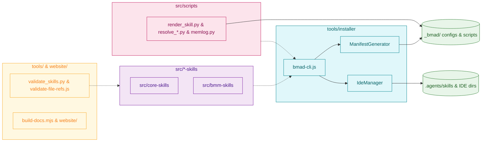
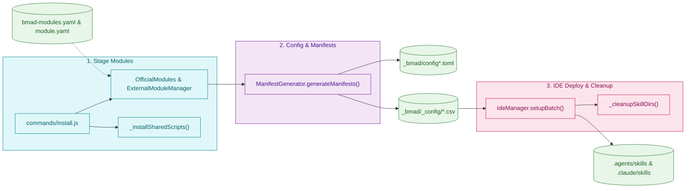
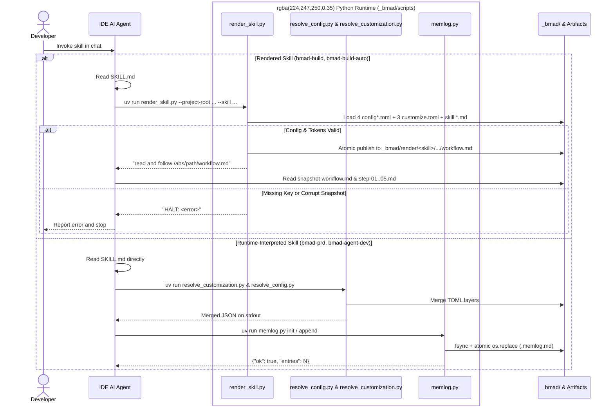
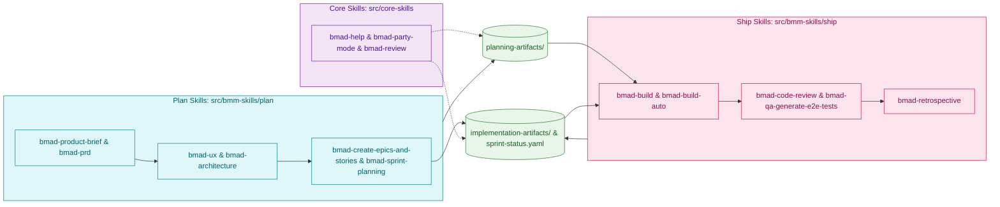

# План онбординга в репозиторий BMAD-METHOD (v6.12.4)

Пошаговый маршрут изучения репозитория **BMAD-METHOD (`v6.12.4`)**: от общей ментальной модели к устройству установщика, Python-рантайма, архитектуры скиллов и системы валидации.

---

## 0. Главная ментальная модель

В репозитории **нет собственного LLM-сервера, API-клиента к провайдерам моделей или фонового демона**. В качестве исполнителя BMAD использует уже установленную у разработчика AI-IDE (Cursor, Claude Code, Codex, GitHub Copilot и ещё ~35 платформ), а сам репозиторий разделён на **четыре слоя**:

1. **Install-time слой (Node.js CLI)** — `tools/installer/`: интерактивный установщик (`npx bmad-method install`), который собирает ответы пользователя, подтягивает встроенные и внешние модули, генерирует TOML-конфиги и CSV-манифесты в `_bmad/` и раскладывает нативные скиллы по папкам выбранных IDE.
2. **Promptware слой (Agent Skills)** — `src/core-skills/` и `src/bmm-skills/`: папки со стандартизированными `SKILL.md`, пошаговыми инструкциями (`step-*.md`), шаблонами и дефолтными настройками `customize.toml`. Эти Markdown-файлы — «исходный код» воркфлоу и персон агентов.
3. **Детерминированный Runtime-слой (Python 3.11 + `uv`)** — `src/scripts/` и `scripts/` внутри отдельных скиллов: компактные Python-скрипты без внешних зависимостей (на базе стандартного `tomllib`), которые AI-агент вызывает через `uv run` прямо во время выполнения скилла — для слияния слоёв конфигов, компиляции неизменяемых снэпшотов промптов и атомарной записи лога памяти (`.memlog.md`).
4. **Validation & Docs пайплайн** — `tools/validate_skills.py`, `tools/validate-file-refs.js`, `tools/build-docs.mjs` и Astro/Starlight сайт в `website/` + контент в `docs/`.

Карта основных подсистем репозитория и формируемых ими артефактов в целевом проекте (бирюзовый — Node.js установщик, фиолетовый — исходники скиллов, розовый — Python-рантайм, жёлтый — валидация и документация, зелёный — хранилища в проекте пользователя):



---

## Этап 1. Точка входа и реестр модулей (30–40 минут)

Начни с корневых манифестов — они показывают границы системы и состав публикуемого пакета.

### Маршрут чтения на этапе 1

1. `package.json` — точка входа пакета (`"bin": { "bmad": "tools/installer/bmad-cli.js" }`) и скрипт `npm run quality`, объединяющий все проверки репозитория.
2. `AGENTS.md` — правила репозитория (философия промптов: минимум экзотических веток, так как длина промпта оплачивается на каждом запуске; тестируется только детерминированный код).
3. `bmad-modules.yaml` — единый реестр официальных внешних модулей (`bmb`, `cis`, `tea`, `bmad-loop`, `gds` и deprecated-модулей), которые установщик клонирует с GitHub по тегам и каналам (`stable` / `next` / `pin`).
4. `.claude-plugin/marketplace.json` — альтернативный способ дистрибуции: список всех 29 встроенных скиллов как нативного плагина Claude.
5. `src/core-skills/module.yaml` и `src/bmm-skills/module.yaml` — схемы вопросов установщика (`prompt`, `default`, `scope: user | team`) и реестр командных агентов (`Mary`, `John`, `Sally`, `Winston`, `Amelia`).

---

## Этап 2. Установщик `tools/installer/` под капотом (1.5–2 часа)

Установщик выполняет нетривиальные операции с файловой системой, которые важно увидеть в коде, чтобы понимать устройство папки `_bmad/`.

### Маршрут чтения на этапе 2

1. `tools/installer/bmad-cli.js` — обёртка на `commander`, проверяет обновления в npm и динамически загружает команды из `tools/installer/commands/` (`install.js`, `status.js`, `uninstall.js`).
2. `tools/installer/core/installer.js` — ядро установки (`Installer.install()` и `Installer.quickUpdate()`):
   - **Сохранение кастомизаций при обновлении** (`_prepareUpdateState` → `detectCustomFiles` → `_restoreUserFiles`): сверяет SHA-256 хеши файлов на диске со старым `_bmad/_config/files-manifest.csv`. Новые пользовательские файлы сохраняются как есть, а изменённые управляемые файлы копируются в `.bak`.
   - **Копирование Python-рантайма** (`_installSharedScripts`): копирует `src/scripts/*` (кроме `tests/` и `__pycache__`) в `_bmad/scripts/`, создаёт `.gitignore` для `_bmad/custom/*.user.toml` и `_bmad/render/`.
   - **Сборка манифестов** (`tools/installer/core/manifest-generator.js`): рекурсивно обходит `_bmad/<module>`, находит все `SKILL.md`, извлекает `name` и `description` из frontmatter и генерирует:
     - `_bmad/config.toml` (team-scope настройки + реестр `[agents.<code>]`) и `_bmad/config.user.toml` (user-scope настройки, такие как `user_name` и `communication_language`);
     - пустые стабы `_bmad/custom/config.toml` и `_bmad/custom/config.user.toml` (установщик никогда не перезаписывает их при повторных установках);
     - `_bmad/_config/skill-manifest.csv`, `files-manifest.csv`, `manifest.yaml` и объединённый каталог помощи `_bmad/_config/bmad-help.csv` (`mergeModuleHelpCatalogs`).
3. `tools/installer/ide/platform-codes.yaml` и `tools/installer/ide/_config-driven.js` — **единый config-driven инсталлятор для 39 IDE**:
   - Большинство современных инструментов (Cursor, Codex, Gemini CLI, Copilot, Windsurf, OpenCode, Roo и др.) используют общую директорию `.agents/skills`. `IdeManager.setupBatch()` в `tools/installer/ide/manager.js` дедуплицирует запись: если выбрано несколько платформ с общим `target_dir`, файлы скиллов копируются один раз.
   - Для платформ с отдельным списком команд или кастомных агентов (`github-copilot` → `.github/agents/*.agent.md` с фильтром `agents-only` по наличию секции `[agent]` в `customize.toml`; `opencode` → `.opencode/commands/*.md`) метод `installCommandPointers()` генерирует легковесные файлы-указатели.
4. **Финальная зачистка (`_cleanupSkillDirs` в `installer.js`)**: после копирования скиллов в директории IDE установщик **удаляет исходные папки скиллов из `_bmad/`**, исключая дублирование. В `_bmad/` остаются конфиги, манифесты, `scripts/`, `custom/` и кэш `render/`.

Пайплайн работы `Installer.install()` от чтения реестра до очистки временных копий (бирюзовый — загрузка модулей и скриптов, фиолетовый — генерация конфигов и манифестов, розовый — деплой в IDE и очистка, зелёный — файлы на диске):



---

## Этап 3. Python-рантайм: слоёные TOML-конфиги, рендерер снэпшотов и `.memlog.md` (1.5 часа)

Этот слой обеспечивает строгую работу с конфигурацией, переопределения на уровне команды/разработчика и защиту промптов во время исполнения.

### Маршрут чтения на этапе 3 (`src/scripts/`)

1. `src/scripts/config_utils.py` — правила структурного слияния TOML (`structural_merge`):
   - Скаляры перезаписываются верхним слоем, таблицы объединяются рекурсивно.
   - **Массивы таблиц с ключом**: если все элементы содержат строковое поле `code` или `id` (например, `[[agent.menu]]` или `[[workflow.review_layers]]`), элементы с совпадающим `code`/`id` заменяются на месте, а новые добавляются в конец. Обычные массивы строк (`principles`, `persistent_facts`) конкатенируются.
   - Центральный конфиг (`load_central_config`) объединяет **4 слоя**: `_bmad/config.toml` → `_bmad/config.user.toml` → `_bmad/custom/config.toml` → `_bmad/custom/config.user.toml`.
   - Кастомизация скилла (`load_customization`) объединяет **3 слоя**: `{skill-root}/customize.toml` → `_bmad/custom/<skill>.toml` → `_bmad/custom/<skill>.user.toml`.
2. `src/scripts/resolve_config.py` и `src/scripts/resolve_customization.py` — CLI-обёртки, отдающие итоговый конфиг в `stdout` в формате UTF-8 JSON.
3. `src/scripts/render_skill.py` — **компилятор неизменяемых снэпшотов** (используется в `bmad-build` и `bmad-build-auto`):
   - Читает все `*.md` скилла (кроме `SKILL.md`), за один проход подставляет токены `{{.key}}`, `{{config.key}}`, `{workflow.key}` (включая рендеринг `[[workflow.review_layers]]` в готовые Markdown-секции) и заменяет ссылки `[[bmad-snapshot:step-01-clarify-and-route.md]]` на абсолютные пути внутри снэпшота.
   - Считает `generation_hash` (SHA-256 от канонического JSON со входными параметрами, хешами исходников и хешем самого `render_skill.py`).
   - Через временную staging-директорию и атомарный `os.rename` публикует снэпшот в `_bmad/render/<skill>/<slug>-<root_hash>/<generation_hash>/` вместе с `manifest.json` и печатает агенту команду `read and follow .../workflow.md` (либо `HALT: <причина>` при ошибке конфигурации).
4. `src/scripts/memlog.py` — **append-only рабочая память сессии** (`.memlog.md`):
   - Три инварианта: только дописывание в конец (`append`), атомарная запись «вслепую» через `temp + flush + fsync + os.replace` без перечитывания файла в середине диалога, отсутствие мутируемых статусов во frontmatter (завершение сессии фиксируется событием `- (event) session complete`).

Сравнение двух режимов активации скилла в рантайме — компилируемого через `render_skill.py` и интерпретируемого на лету:



---

## Этап 4. Архитектура скиллов и жизненный цикл BMM (2 часа)

Чтобы не читать все ~40 директорий скиллов подряд, изучи по одному эталонному представителю каждого из пяти архетипов.

### 5 эталонных скиллов для разбора

1. **Навигатор по состоянию проекта**: `src/core-skills/bmad-help/SKILL.md` + `src/bmm-skills/module-help.csv`
   - Показывает, как `bmad-help` определяет текущий этап работы: читает `_bmad/_config/bmad-help.csv`, резолвит пути артефактов через `resolve_config.py`, ищет созданные файлы на диске и проверяет их завершённость (`draft` vs `final`), рекомендуя следующий `required` или опциональный шаг.
2. **Персона агента**: `src/bmm-skills/agents/bmad-agent-dev/SKILL.md` + `customize.toml`
   - Все 5 агентов в `src/bmm-skills/agents/` построены по единому 8-шаговому шаблону активации (`resolve_customization` → `prepend` → принятие персоны → загрузка `persistent_facts` с поддержкой `file:` глобов → `resolve_config` → приветствие с иконкой → `append` → рендер меню `[[agent.menu]]` и ожидание ответа).
3. **Интерактивный Discovery-скилл с субагентами и `.memlog.md`**: `src/bmm-skills/plan/bmad-prd/SKILL.md`
   - Демонстрирует паттерн *Extract, don't ingest* (большие входные документы обрабатываются субагентами, чтобы не перегружать основное окно контекста), фиксацию решений через `memlog.py`, вынос технических деталей в `addendum.md` и финальный `Reviewer Gate` с параллельными субагентами-ревьюерами.
4. **Компилируемый Step-File воркфлоу**: `src/bmm-skills/ship/bmad-build/`
   - Читай по порядку: `SKILL.md` → `customize.toml` → `workflow.md` → `step-01-clarify-and-route.md` → `step-02-plan.md` → `step-03-implement.md` → `step-04-review.md` → `step-05-present.md`.
   - Ключевые механизмы: **Just-In-Time загрузка шагов** (запрет читать будущие `step-*.md` заранее), передача реализации контекстно-чистому субагенту (`implementation_handoff`) и многослойное ревью диффа в `step-04-review.md` (`blind-hunter` с расчётом минимального порога находок по размеру диффа, `edge-case-hunter`, `verification-gap`).
5. **Скилл со встроенными Python-утилитами**: `src/bmm-skills/plan/bmad-sprint-planning/` (`scripts/sprint_plan.py`), `src/bmm-skills/ship/bmad-retrospective/` (`scripts/git_evidence.py`, `scripts/sprint_status.py`) и `src/core-skills/bmad-party-mode/` (`scripts/resolve_party.py`).

Связь скиллов планирования, реализации и ядра через файловые артефакты проекта (бирюзовый — фаза Plan, розовый — фаза Ship, фиолетовый — сквозные Core-скиллы, зелёный — директории артефактов проекта):



---

## Этап 5. Контракты качества, валидаторы и тесты (1 час)

Перед внесением изменений в скиллы или скрипты разбери систему автоматических проверок.

### Маршрут чтения на этапе 5

1. `tools/skill-validator.md` — **спецификация из 20 правил валидации скиллов** (`SKILL-01..07`, `PATH-01..05`, `STEP-04..05`, `SEQ-01..02`, `TPL-01`, `REF-01..03`) и сводная таблица всех форм токенов (`{name}`, `{workflow.key}`, `{agent.key}`, `{{.key}}`, `{{config.key}}`, `{{placeholder}}`, `[[bmad-snapshot:file.md]]`).
2. `tools/validate_skills.py` — детерминированный валидатор первых 10 правил (запускается в CI с флагом `--strict`).
3. `tools/validate-file-refs.js` — проверка целостности ссылок и CSV-каталогов (`module-help.csv`).
4. `test/` и `src/**/tests/test_*.py` — тесты покрывают **только детерминированный код** (установщик, каналы, шимы, слияние TOML, `render_skill.py`, `sprint_plan.py`, `validate_skills.py`).
5. `web-bundles/` + `tools/bundle-web-bundles.js` — сборка автономных бандлов для ChatGPT Custom GPTs и Gemini Gems; `tools/build-docs.mjs` + `website/` — сборка документации на Astro + Starlight.

---

## Практический чеклист: 4 команды для проверки руками

1. **Прогнать валидатор скиллов и ссылок**:

   ```bash
   npm run validate:skills && npm run validate:refs
   ```

2. **Установить BMAD из локального репозитория в песочницу `/tmp/bmad-sandbox`**, чтобы осмотреть сгенерированные `_bmad/` и `.agents/skills/`:

   ```bash
   mkdir -p /tmp/bmad-sandbox && node tools/installer/bmad-cli.js install --directory /tmp/bmad-sandbox --modules bmm --tools cursor --yes
   ```

   После установки проверь содержимое `/tmp/bmad-sandbox/_bmad/config.toml`, `/tmp/bmad-sandbox/_bmad/_config/bmad-help.csv`, `/tmp/bmad-sandbox/_bmad/_config/skill-manifest.csv` и `/tmp/bmad-sandbox/.agents/skills/`.

3. **Запустить Python-резолвер и компилятор снэпшота на песочнице**:

   ```bash
   uv run /tmp/bmad-sandbox/_bmad/scripts/resolve_config.py --project-root /tmp/bmad-sandbox
   uv run /tmp/bmad-sandbox/_bmad/scripts/render_skill.py --project-root /tmp/bmad-sandbox --skill /tmp/bmad-sandbox/.agents/skills/bmad-build
   ```

   Открой напечатанный путь `/tmp/bmad-sandbox/_bmad/render/bmad-build/.../workflow.md` и соседний `manifest.json`, чтобы увидеть результат подстановки `{{.communication_language}}`, `{workflow.review_layers}` и `[[bmad-snapshot:...]]`.

4. **Запустить полный пайплайн качества репозитория** (аналог `.github/workflows/quality.yaml`):

   ```bash
   npm run quality
   ```
